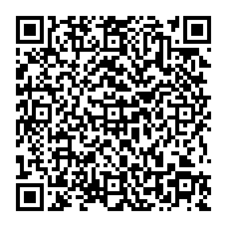

# Test QR codes

Scan these with **New chat › … › Scan** or **Pharos › Add with QR code** to try the
in-app scanner. Show them on a computer screen. Generated with the `qrcode`
Python package; the identities come from `keryx keygen` and are throwaway.

## contact-bea

Contact. Confirm dialog «Add bea?», then her direct chat opens.


```
skypost:id/WNIDDELL3JE6OEF6CLBTDPAXBWKI6WSGPOQJQLCMKFDFBAUHVYVQ?n=bea&c=EA5BBB
```

## pharos-radioclub

Pharos. Confirm dialog «Trust the Pharos radioclub?»; it appears in the Pharos screen (verified, active if it is the first).


```
skypost:id/TOZPXNPHENX5CH4N5JSXR4MKGXVDCAOIUTE6YVJUN5IZWZDZYYLA?n=radioclub&c=EA5RCV&k=pharos
```

## group-montana

Group invitation. Confirm dialog «Join Montaña?», then the group chat opens. Test key: never use it for real.


```
skypost:group/AAAQEAYEAUDAOCAJBIFQYDIOB4IBCEQTCQKRMFYYDENBWHA5DYPQ?n=Monta%C3%B1a
```

## meshcore-refugio

MeshCore contact. Needs an active Pharos; opens a MeshCore chat through it. The camera app does not open Skypost for these.



```
meshcore://contact/add?name=Refugio%20Test&public_key=5a5a5a5a5a5a5a5a5a5a5a5a5a5a5a5a5a5a5a5a5a5a5a5a5a5a5a5a5a5a5a5a&type=1
```

## not-a-code

Not a Skypost/MeshCore code: the app says it does not recognise it.


```
https://code.alvaroedo.io/alvaroemtnez/Skypost
```
